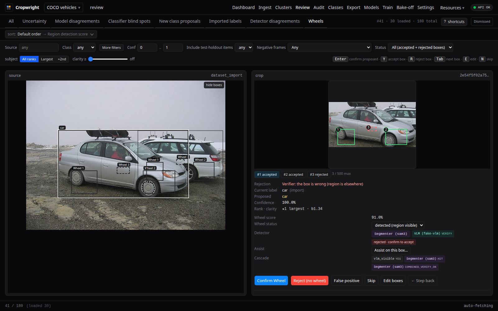

# OpenProcessor

**A backend for computer-vision dataset curation and training, with a fast
inference API underneath.** Ingest images, detect and crop regions, label them
with people and a vision-language model, import and combine datasets, export,
train and promote models. It works for any image domain, not one built-in use
case.

Underneath is a unified REST API on NVIDIA Triton Inference Server with
TensorRT engines: object detection, face recognition, visual search, OCR and
embeddings.

The optional web UI, **Cropwright**, is a frontend for the curation API. Every
route also works from `curl`, `httpx` or the generated OpenAPI client. See
[`docs/VISION_AND_GOALS.md`](docs/VISION_AND_GOALS.md) for the project's scope
and standards.



**Documentation:** <https://davidamacey.github.io/OpenProcessor/>

**Where to start.** Not sure whether you need the inference API or the curation
tools? Read [Choose your path](docs-site/docs/getting-started/choose-your-path.mdx).
The user documentation lives in [`docs-site/docs/`](docs-site/docs/); this
README is the overview, the install and a first result.

---

## What you get

**Inference API** (port 4603, `/v1` twin for the core routes)

- Object detection (YOLO11 and YOLO26 side by side), batch up to 64 images.
- Face detection, ArcFace embeddings, 1:1 verify, search and 1:N identify.
- MobileCLIP image and text embeddings, visual search over OpenSearch k-NN.
- PP-OCRv5 text detection and recognition.
- Combined analysis, ingest into the visual-search indexes, FAISS clustering
  and albums.

**Curation and training** (`/curation`, all project scoped)

- **Isolated projects.** Each project has its own indexes, directories, class
  registry, settings and jobs. Isolation is enforced at the OpenSearch
  transport layer.
- **Config you can version.** Prompt packs, region profiles, keymaps and the
  VLM choice are revisioned documents with activate and roll back.
- **One or many regions per item.** `region_boxes` is always a list; each box
  has its own state, text, cluster and embedding.
- **Ingest policy and bulk ingest.** The stock detector stores every detection
  of its label space as an unlabeled proposal; a per-project policy decides
  what is kept and what gets a vector. A folder, a manifest or an S3 bucket
  runs as a background job with a preview first.
- **VLM labeling and assist.** A deployment-wide registry of OpenAI-compatible
  endpoints with a local model catalog; each project activates one (a project
  calls no VLM until it does). Remote endpoints need an explicit
  acknowledgement because crops leave the host. Selective assist
  (`POST /curation/projects/{project}/assist/runs`) and the auto-label loop
  send crops, clusters or filters to the VLM inside a hard budget; see
  [Selective VLM and segmenter assist](docs-site/docs/guides/selective-assist.mdx)
  and [Auto-label loop](docs-site/docs/guides/auto-label-loop.mdx).
- **Dataset import, combine, export, train, promote.** YOLO, COCO and
  OpenProcessor-export layouts; merge up to eight projects; bake-off model
  comparison; promotion back into Triton.
- **Class identity by name.** Import, combine, export, train, promote and
  model sharing map classes by name, never by index.
- **The lock rule.** A human-set or import-validated label or box, and
  anything in the frozen test holdout, is never overwritten by an automated
  writer.

What changed in each release, with upgrade notes, is in
[`CHANGELOG.md`](CHANGELOG.md). The whole curation surface is in
[`contracts/openapi/curation.json`](contracts/openapi/curation.json); the
guides are under [`docs-site/docs/guides/`](docs-site/docs/guides/).

---

## Quick Start

### One-line install

```bash
curl -fsSL https://raw.githubusercontent.com/davidamacey/OpenProcessor/main/setup-openprocessor.sh | bash
```

This installs the latest published release into `./openprocessor/`: no git
clone, no local image build, no host Python. The script you pipe in resolves
the release, downloads that release's own `setup-openprocessor.sh` and
`SHA256SUMS`, checks the checksum, and runs the verified copy. Images are
pinned by digest (`images.lock`). It asks which tiers you want, picks GPUs,
exports the TensorRT engines inside the containers, starts everything and runs
a health check.

**Needs:** Linux, Docker with Compose v2, an NVIDIA GPU with the NVIDIA
Container Toolkit, and disk for the tiers you pick (about 50 GB for `core`,
about 125 GB for everything). First install takes 30-60 minutes, mostly image
pulls and TensorRT export. Full prerequisites:
[INSTALLATION.md](INSTALLATION.md#prerequisites).

### Tiers

Six tiers, chosen by the installer or `--tiers`: `core` (Triton, the API on
port 4603, OpenSearch), `curation`, `segmenter`, `vlm`, `trainer` and
`cropwright`. Each adds images and needs VRAM; `core` needs about 50 GB of disk
and a 16 GB card (`--profile minimal` for 6-8 GB cards). The size and VRAM
table per tier is in
[the installer walkthrough](docs-site/docs/getting-started/installer.mdx), the
flags in [INSTALLATION.md](INSTALLATION.md#installer-flags). Monitoring is not
a tier: add `--with-monitoring`.

### Unattended install

```bash
curl -fsSL https://raw.githubusercontent.com/davidamacey/OpenProcessor/main/setup-openprocessor.sh \
  | bash -s -- --tiers core,curation,cropwright --unattended
```

`--unattended` never prompts: every choice comes from flags or their defaults,
and a step that needs consent (a non-loopback `--bind`, an external VLM, a
purge) fails unless its consent variable is set. Use `--all` for every tier,
`--version vX.Y.Z` to pin a release, `--dry-run` to see every command without
running any.

### Verify the download yourself

```bash
V=vX.Y.Z   # the release you want
curl -fsSLO https://github.com/davidamacey/OpenProcessor/releases/download/$V/setup-openprocessor.sh
curl -fsSLO https://github.com/davidamacey/OpenProcessor/releases/download/$V/SHA256SUMS
grep ' setup-openprocessor.sh$' SHA256SUMS | sha256sum -c -
bash setup-openprocessor.sh --version "$V"
```

`SHA256SUMS` comes from the same place as the files it covers. It proves
**integrity**, **not authenticity**: anyone who could replace the release files
could replace `SHA256SUMS` too (the same holds for `images.lock`). Signed
releases are follow-up work.

### Network access

The API stays bound to 127.0.0.1. Cropwright is reachable on your LAN by
default (homelab or small-business use), behind a shared HTTP basic-auth login;
`--local-only` keeps everything on loopback. Never port-forward any
OpenProcessor port to the public internet. Policy: [SECURITY.md](SECURITY.md);
how-to: [Security and network exposure](docs-site/docs/deployment/security.mdx).

### After the install

```bash
cd openprocessor
./openprocessor status            # services and health
./openprocessor logs api -f       # live logs
./openprocessor sample coco       # fetch a public COCO sample (200 images)
./openprocessor vlm list          # the local VLM catalog
./openprocessor upgrade           # to the latest release (backs up first)
./setup-openprocessor.sh --repair      # also --rollback and --uninstall
```

Every subcommand is listed in
[INSTALLATION.md](INSTALLATION.md#the-openprocessor-cli).

### Install from source

For development, or to build the images yourself:

```bash
git clone https://github.com/davidamacey/OpenProcessor.git && cd OpenProcessor && ./scripts/setup.sh
```

`scripts/setup.sh` detects your GPU, picks a profile, downloads the models,
exports them to TensorRT and starts the services (`--yes` for no prompts, or
`--profile=standard --gpu=0 --yes`). In a checkout, manage the stack with
`make up`, `make curation-up`, `make status` and `make down`; `make dev-up`,
`make dev-ps` and `make dev-down` run a dev deployment with every profile.
Set `COMPOSE_PROJECT_NAME`, `OP_IMAGE_REPO` and `OP_IMAGE_TAG` in `.env` to
keep locally built images separate from published ones. Manual steps:
[INSTALLATION.md](INSTALLATION.md#install-from-source).

Images are on Docker Hub under versioned tags
(`davidamacey/openprocessor:<version>`, `davidamacey/openprocessor-triton:<version>`;
`<version>` is the `VERSION` file); the installer never uses `:latest`.

---

## Your first result

### Inference

```bash
curl http://127.0.0.1:4603/health
curl -X POST http://127.0.0.1:4603/detect -F "image=@your-image.jpg"
```

Interactive API docs are at `http://127.0.0.1:4603/docs`. The core routes are
listed under [API Endpoints](#api-endpoints).

### Curation

Curation routes live under `/curation/projects/{project}/...`. The `default`
project exists after the first start; create more with
`POST /curation/projects`. The slug is 2-32 characters: lowercase letters,
digits and single hyphens, starting with a letter.

```bash
API=http://127.0.0.1:4603/curation

# 1. create a project (slug is permanent; display_name is editable)
curl -X POST $API/projects -H 'Content-Type: application/json' \
  -d '{"slug": "cars", "display_name": "Cars"}'

# 2. add classes (class identity is the name)
curl -X POST $API/projects/cars/classes -H 'Content-Type: application/json' \
  -d '{"name": "car"}'
```

No dataset ships in this repo. Fetch a small, license-filtered public COCO 2017
subset (200 images, 20 per class, about 1-2 minutes):

```bash
make sample-coco-readme   # or, from an installed deployment: ./openprocessor sample coco
```

It writes `data/samples/coco_va_readme/` (images, `ATTRIBUTION.csv`,
`coco_gt.json`; gitignored) from a pinned selection filtered to Flickr licenses
safe to redistribute crops of (never NonCommercial or NoDerivs).
`make sample-coco`, `make sample-plates` and `make sample-clean` use the same
tool. Then, in a source checkout:

```bash
# 1. The stock detector stores every detection of its whole label space (all
#    80 COCO classes) as an unlabeled proposal. To store or embed less, set the
#    per-project ingest policy (PUT /curation/projects/{project}/ingest/policy).
# 2. Point OP_SOURCE_ROOT_HOST at data/samples in .env (the compose mount
#    target is fixed at /data/source), set the ingest detector (ingest answers
#    503 until it is set), then recreate the services that mount it: api,
#    curation-detection-worker, curation-auto-label-worker,
#    curation-assist-loop-worker.
cat >> .env <<'EOF'
OP_INGEST_PRIMARY_DETECTOR_MODEL=yolov11_small_trt_end2end
OP_SOURCE_ROOT_HOST=./data/samples
EOF
make up && make curation-up
# 3. --folder is a container path under the /data/source mount:
docker compose -p openprocessor exec api python scripts/curation/bulk_ingest.py \
  --folder /data/source/coco_va_readme/images --project cars
```

An installed directory already has `OP_SOURCE_ROOT_HOST=./data`, so skip step 2
and use `--folder /data/source/samples/coco_va_readme/images`. The full
walkthrough, with the expected result after each step, is the
[Quick start](docs-site/docs/getting-started/quick-start.mdx).

### Example: cars and wheels

`examples/` holds a complete, public, multi-region example: the primary
detector finds cars, then the region stage finds the wheels on each car.

```bash
make sample-coco-cars      # 60 CC BY car images into data/samples/coco_car
.venv/bin/python scripts/examples/wheel_example_live.py \
  --api http://localhost:4603 --project wheels \
  --container-dir /data/source/coco_car/images
```

The script creates the project, activates
`examples/region_profiles/vehicle_wheel.json` and
`examples/prompt_packs/vehicle_wheel.json`, ingests the images, waits for the
detection worker and exports the wheel boxes. It needs the live stack with the
segmenter and an activated VLM. Walkthrough:
[Wheel example](docs-site/docs/guides/wheel-example.mdx).

---

## API Endpoints

All endpoints are on port **4603**. The routes below are also under `/v1`.
Inputs and returns per route: [Core routes](docs-site/docs/api-reference/core.mdx).

| Group | Endpoint | Method | Description |
|---|---|---|---|
| Detection | `/detect` | POST | YOLO object detection |
| | `/detect/batch` | POST | Batch detection (up to 64 images) |
| Faces | `/faces/detect` | POST | Face detection with landmarks (SCRFD) |
| | `/faces/recognize` | POST | Detection + ArcFace 512-dim embeddings |
| | `/faces/verify` | POST | 1:1 face comparison (two images) |
| | `/faces/search` | POST | Find similar faces in the index |
| | `/faces/identify` | POST | 1:N face identification |
| Embeddings | `/embed/image`, `/embed/text` | POST | MobileCLIP 512-dim embeddings |
| | `/embed/batch` | POST | Batch image embeddings |
| | `/embed/boxes` | POST | Per-box crop embeddings |
| Search | `/search/image` | POST | Image-to-image similarity |
| | `/search/text` | POST | Text-to-image search |
| | `/search/face` | POST | Face similarity |
| | `/search/ocr` | POST | Images by recognized text |
| | `/search/object` | POST | Object-level search (vehicles and people; any other class is `422 object_class_not_indexed`) |
| Ingest | `/ingest` | POST | Ingest one image (indexes faces, OCR, objects) |
| | `/ingest/batch` | POST | Batch ingest (up to 64 images) |
| | `/ingest/directory` | POST | Bulk ingest from a server directory |
| OCR | `/ocr/predict` | POST | Extract text (PP-OCRv5) |
| | `/ocr/batch` | POST | Batch OCR |
| Analysis | `/analyze` | POST | Detection + faces + CLIP + OCR in one call |
| | `/analyze/batch` | POST | Batch analysis |
| Clusters | `/clusters/train/{index}` | POST | Train FAISS clustering for an index |
| | `/clusters/stats/{index}` | GET | Cluster statistics |
| | `/clusters/{index}/{cluster_id}` | GET | Cluster members |
| | `/clusters/albums` | GET | Auto-generated albums |
| Query | `/query/image/{image_id}` | GET | Stored image data |
| | `/query/stats` | GET | Statistics for every index |
| | `/query/duplicates` | GET | Duplicate groups |
| Models | `/models` | GET | Models in the Triton repository |
| | `/models/{model_name}/load`, `/unload` | POST | Runtime load and unload |
| Health | `/health` | GET | Service health |
| | `/ready` | GET | Readiness: Triton, its required models and OpenSearch; `503` names any model not `READY` |

Persons, model upload and export, and the remaining query routes are in
[Core routes](docs-site/docs/api-reference/core.mdx). With
`OP_FACES_ENABLED=false` the face and person routes answer `400` with
`error: faces_disabled`; see [SECURITY.md](SECURITY.md#privacy-face-data).

The `/curation` routes are **not** mounted under `/v1`; they exist only at
`/curation` (the prefix is `OP_API_PREFIX`). Every curation route is listed in
[`contracts/openapi/curation.json`](contracts/openapi/curation.json), grouped
and explained in
[docs/design/curation_api_contract.md](docs/design/curation_api_contract.md),
and the TypeScript item types are in [`contracts/`](contracts/).

**No authentication.** The core API and the curation subsystem have no
authentication, authorization or rate limiting. Run them on a trusted machine
or private network behind your own reverse proxy, never on the public internet.
See **[SECURITY.md](SECURITY.md)**.

### Usage examples

Coordinates are normalized `0.0-1.0`. Python examples and more response shapes:
[Core routes](docs-site/docs/api-reference/core.mdx#response-shapes).

```bash
# Detection
curl -X POST http://localhost:4603/detect -F "image=@photo.jpg"
# {"detections": [{"x1": 0.09, "y1": 0.28, "x2": 0.87, "y2": 0.99, "confidence": 0.92,
#   "class": 0, "class_name": "person"}], "num_detections": 1, "status": "success",
#   "image": {"width": 1920, "height": 1080}, "total_time_ms": 12.5}

# Faces: box is [x1, y1, x2, y2]; landmarks is a flat list of 10 floats
curl -X POST http://localhost:4603/faces/recognize -F "image=@face.jpg"
# {"num_faces": 1, "faces": [{"box": [0.30, 0.10, 0.50, 0.40], "score": 0.98,
#   "landmarks": [0.35, 0.20, 0.45, 0.20, 0.40, 0.28, 0.36, 0.35, 0.44, 0.35]}],
#   "embeddings": [[...512 floats...]]}

# Embedding
curl -X POST http://localhost:4603/embed/image -F "image=@photo.jpg"
# {"embedding": [...512 floats...], "embedding_norm": 1.0, "indexed": false, "status": "success"}

# Text search (query parameters, not a JSON body: `text`, not `query`)
curl -X POST "http://localhost:4603/search/text?text=sunset+beach&top_k=10"
# {"status": "success", "query_type": "text", "results": [{"image_id": "...", "image_path": "...",
#   "score": 0.31}], "total_results": 1, "search_time_ms": 8.2}

# Ingest
curl -X POST http://localhost:4603/ingest -F "image=@photo.jpg" -F "image_id=photo_001"
# {"status": "success", "image_id": "photo_001", "num_detections": 1, "num_faces": 2,
#   "indexed": {"global": true, "vehicles": 1, "people": 0, "faces": 2}}

# OCR
curl -X POST http://localhost:4603/ocr/predict -F "image=@document.jpg"
# {"status": "success", "texts": ["Invoice", "Total: $100"], "num_texts": 2, "regions": [...]}

# Combined analysis (no indexing)
curl -X POST http://localhost:4603/analyze -F "image=@scene.jpg"
# {"detections": [...], "faces": [...], "ocr": {...}, "num_detections": 3, "num_faces": 1}
```

---

## Hardware and models

An NVIDIA GPU with 8 GB or more VRAM (Ampere or newer; 16 GB+ recommended),
16 GB RAM, 16 CPU cores and Docker with the NVIDIA Container Toolkit are the
minimum. The installer picks one of four profiles (`minimal`, `small`,
`standard`, `full`) from the free VRAM of the Triton card. Profiles, memory
numbers and sizing: [GPU sizing](docs-site/docs/deployment/gpu-sizing.mdx);
prerequisites: [INSTALLATION.md](INSTALLATION.md#prerequisites); measured
throughput: [docs/PERFORMANCE.md](docs/PERFORMANCE.md).

| Model | Purpose | Backend |
|---|---|---|
| YOLO11 / YOLO26 | Object detection (both served by one Triton and one API) | TensorRT |
| SCRFD-10G | Face detection + landmarks | TensorRT |
| ArcFace | Face embeddings (512-dim) | TensorRT |
| MobileCLIP | Image/text embeddings (512-dim) | TensorRT |
| PP-OCRv5 | Text detection + recognition | TensorRT |
| PE-Core-L14-336 | Curation embeddings (1024-dim, image and text) | TensorRT image, Triton CPU text |
| Segmenter | Region proposals from a text prompt (optional) | HTTP service |
| VLM | Class labels and region verdicts (optional) | OpenAI-compatible endpoint |

Core models run FP16 with dynamic batching. Exporting YOLO26, switching the
default detector (`YOLO_MODEL`) and uploading your own checkpoint:
[Model export](docs-site/docs/getting-started/model-export.mdx) and
[export/README.md](export/README.md).

## Architecture

A FastAPI `api` service (port 4603) calls Triton for GPU inference and
OpenSearch for k-NN search and the curation datastore; optional curation
workers run the region cascade, VLM loop, auto-label driver and clustering
refresh. Services, compose profiles and ports:
[Compose profiles](docs-site/docs/getting-started/compose-profiles.mdx); roles
and data flow: [docs/ARCHITECTURE.md](docs/ARCHITECTURE.md#services-and-compose-profiles).
Monitoring is opt in (`make up-monitoring` or `--with-monitoring`).

## Configuration, testing and benchmarking

Every setting is in `.env` (template: [`env.template`](env.template), with a
"Curation quick-config" block). Reference:
[Configuration (basic)](docs-site/docs/configuration/basic.mdx) and
[(advanced)](docs-site/docs/configuration/advanced.mdx). Tests and dev setup:
[CONTRIBUTING.md](CONTRIBUTING.md). Benchmarks:
[docs/PERFORMANCE.md](docs/PERFORMANCE.md#benchmarking).

---

## Documentation

- **[Published docs site](https://davidamacey.github.io/OpenProcessor/)**, source in [`docs-site/docs/`](docs-site/docs/) (`make docs-build`)
  - [Choose your path](docs-site/docs/getting-started/choose-your-path.mdx)
  - [Quick start](docs-site/docs/getting-started/quick-start.mdx)
  - [One-line installer](docs-site/docs/getting-started/installer.mdx)
  - [Configuration](docs-site/docs/configuration/basic.mdx)
  - [API reference](docs-site/docs/api-reference/overview.mdx)
  - [Curation workflow](docs-site/docs/operations/curation-workflow.mdx)
  - [Cropwright user guide](docs-site/docs/cropwright/getting-started/introduction.md)
- **[INSTALLATION.md](INSTALLATION.md)**: installer, CLI and source install
- **[CONTRIBUTING.md](CONTRIBUTING.md)**: dev setup, tests, commit conventions
- **[SECURITY.md](SECURITY.md)**: read before exposing the API beyond a trusted network
- **[docs/ARCHITECTURE.md](docs/ARCHITECTURE.md)**: components, data model, runtime topology
- **[docs/CURATION.md](docs/CURATION.md)**: curation user guide
- **[docs/PERFORMANCE.md](docs/PERFORMANCE.md)**: measurement log and benchmarking
- **[docs/design/program/00_index.md](docs/design/program/00_index.md)**: what to do next (clustering research outcome and plans)
- **[docs/design/curation_api_contract.md](docs/design/curation_api_contract.md)**: route and wire-model reference
- **[docs/VISION_AND_GOALS.md](docs/VISION_AND_GOALS.md)**: scope and standards
- **[docs/opensearch_schema_design.md](docs/opensearch_schema_design.md)**, **[docs/OCR.md](docs/OCR.md)**, **[docs/FACE_RECOGNITION_IMPLEMENTATION.md](docs/FACE_RECOGNITION_IMPLEMENTATION.md)**: index schemas, OCR and face details
- **[contracts/](contracts/)**: generated OpenAPI and TypeScript types
- **[export/README.md](export/README.md)**, **[scripts/README.md](scripts/README.md)**, **[benchmarks/README.md](benchmarks/README.md)**: model export, scripts, benchmark tools
- **[CLAUDE.md](CLAUDE.md)**: orientation for AI coding agents
- **[CHANGELOG.md](CHANGELOG.md)**: release history

---

## Attribution

This project uses:
- [NVIDIA Triton Inference Server](https://github.com/triton-inference-server/server)
- [Ultralytics YOLO](https://github.com/ultralytics/ultralytics)
- [levipereira/ultralytics](https://github.com/levipereira/ultralytics) fork for End2End TensorRT export
- [Apple MobileCLIP](https://github.com/apple/ml-mobileclip)
- [InsightFace ArcFace](https://github.com/deepinsight/insightface)
- [InsightFace SCRFD](https://github.com/deepinsight/insightface/tree/master/detection/scrfd)
- [PaddleOCR](https://github.com/PaddlePaddle/PaddleOCR)
- [Meta Perception Encoder (PE-Core)](https://github.com/facebookresearch/perception_models)
- [Meta Segment Anything 3](https://github.com/facebookresearch/sam3) (optional segmenter)

See [ATTRIBUTION.md](ATTRIBUTION.md) for complete licensing information.

---

## License

This project is licensed under the **GNU Affero General Public License
v3.0 or later (AGPL-3.0-or-later)** — see [LICENSE](LICENSE). It vendors an
AGPL-3.0 Ultralytics fork (`src/ultralytics_patches/`) whose copyleft terms
propagate to the combined work. Third-party components retain their own
licenses (BSD, Apache-2.0, MIT, and others) — see
[ATTRIBUTION.md](ATTRIBUTION.md) for the full per-component table.
