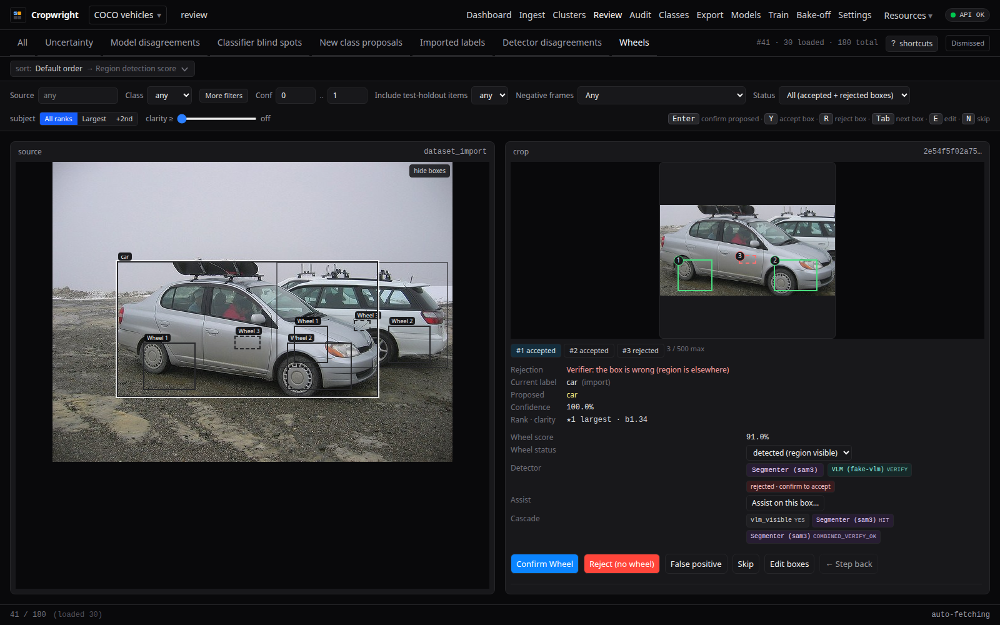

# OpenProcessor

**A backend for computer-vision dataset curation and training, with a fast
inference API underneath.** Ingest images, detect and crop regions, label them
with people and a vision-language model, import and combine datasets, export,
train and promote models. It works for any image domain, not one built-in use
case.

Underneath is a unified REST API on NVIDIA Triton Inference Server with
TensorRT engines: object detection, face recognition, visual search, OCR and
embeddings.

The optional web UI, **Cropwright**, is a frontend for the curation API. Every
route also works from `curl`, `httpx` or the generated OpenAPI client. See
[`docs/VISION_AND_GOALS.md`](docs/VISION_AND_GOALS.md) for the project's scope
and standards.



**Documentation:** <https://davidamacey.github.io/OpenProcessor/>

**Where to start.** Not sure whether you need the inference API or the curation
tools? Read [Choose your path](docs-site/docs/getting-started/choose-your-path.mdx).
The user documentation lives in [`docs-site/docs/`](docs-site/docs/); this
README is the overview, the install and a first result.

---

## What you get

**Inference API** (port 4603, `/v1` twin for the core routes)

- Object detection (YOLO11 and YOLO26 side by side), batch up to 64 images.
- Face detection, ArcFace embeddings, 1:1 verify, search and 1:N identify.
- MobileCLIP image and text embeddings, visual search over OpenSearch k-NN.
- PP-OCRv5 text detection and recognition.
- Combined analysis, ingest into the visual-search indexes, FAISS clustering
  and albums.

**Curation and training** (`/curation`, all project scoped)

- **Isolated projects.** Each project has its own indexes, directories, class
  registry, settings and jobs. Isolation is enforced at the OpenSearch
  transport layer.
- **Config you can version.** Prompt packs, region profiles, keymaps and the
  VLM choice are revisioned documents with activate and roll back.
- **One or many regions per item.** `region_boxes` is always a list; each box
  has its own state, text, cluster and embedding.
- **Ingest policy.** The stock detector stores every detection of its label
  space as an unlabeled proposal. A per-project policy decides what is kept
  and what gets a vector.
- **VLM labeling.** A deployment-wide registry of OpenAI-compatible endpoints
  with a local model catalog; each project activates one. Remote endpoints
  need an explicit acknowledgement because crops leave the host.
- **Dataset import, combine, export, train, promote.** YOLO, COCO and
  OpenProcessor-export layouts; merge up to eight projects; bake-off model
  comparison; promotion back into Triton.
- **Selective VLM assist.** `POST /curation/projects/{project}/assist/runs` sends a crop, a box, a
  selection, a cluster, a sub-cluster or a filter to the VLM, whole or as a
  representative sample, and proposes a cluster label you apply explicitly
  (see [Selective VLM and segmenter assist](docs-site/docs/guides/selective-assist.mdx)).
  A project calls no VLM until it activates one.
- **Bulk ingest.** A folder, a manifest or an S3 bucket runs as a background
  job with a preview first; ingest can also be detection-only.
- **Class identity by name.** Import, combine, export, train, promote and
  model sharing map classes by name, never by index.
- **The lock rule.** A human-set or import-validated label or box, and
  anything in the frozen test holdout, is never overwritten by an automated
  writer.

**What's new in 0.6.0.** Faster ingest (images decoded once, uint8 inputs to
Triton, an FP16 embedding engine, GPU decode for large photos, multi-GPU
embedding, batched writes; numbers in [`docs/PERFORMANCE.md`](docs/PERFORMANCE.md)),
assist runs, bulk and S3 ingest, and a cleaned-up codebase. Upgrading from 0.5.0:
read the upgrade notes in [`CHANGELOG.md`](CHANGELOG.md) (new projects start
with the VLM off, `CROPWRIGHT_*` env names are now `OP_CROPWRIGHT_*`, the
evaluator has its own `evaluator` profile).

The whole curation surface is in
[`contracts/openapi/curation.json`](contracts/openapi/curation.json); the
guides are under [`docs-site/docs/guides/`](docs-site/docs/guides/).

---

## Quick Start

### One-line install

```bash
curl -fsSL https://raw.githubusercontent.com/davidamacey/OpenProcessor/main/setup-openprocessor.sh | bash
```

This installs the latest published release into `./openprocessor/`: no git
clone, no local image build, no host Python. The script you pipe in only
resolves the release, downloads that release's own `setup-openprocessor.sh`
and `SHA256SUMS`, checks the checksum, and runs the verified copy. Images are
pinned by digest (`images.lock`) and checked after the pull. It asks which
tiers you want, picks GPUs, exports the TensorRT engines inside the
containers, starts everything and runs a health check.

**Needs:** Linux, Docker with Compose v2, an NVIDIA GPU with the NVIDIA
Container Toolkit, and disk for the tiers you pick (about 60 GB for `core`,
about 135 GB for everything). First install takes 30-60 minutes, mostly image
pulls and TensorRT export.

### Tiers

| Tier | What you get | Extra images | Needs |
|---|---|---|---|
| `core` | Triton, the API (port 4603), OpenSearch | ~53 GB | ~16 GB VRAM (`--profile minimal` for 6-8 GB cards) |
| `curation` | curation workers, PE-Core embeddings, evaluator | + ~15 GB | + ~2 GB VRAM; implies `core` |
| `segmenter` | SAM 3 segmenter | + ~7 GB | 2-8 GB VRAM; a HuggingFace token with SAM 3 access (gated); implies `curation` |
| `vlm` | local vLLM serving a model from the VLM catalog | + ~19 GB | ~23 GB VRAM for the default; implies `curation` |
| `trainer` | training service + MLflow | + ~9 GB | >= 16 GB free VRAM while training; implies `curation` |
| `cropwright` | the Cropwright web UI (a profile of the same compose project) | + ~65 MB | implies `curation` |

Monitoring (Prometheus, Grafana, Loki) is not a tier: add `--with-monitoring`.
Its dashboards are default-open, so it is off unless you ask.

### Unattended install

```bash
curl -fsSL https://raw.githubusercontent.com/davidamacey/OpenProcessor/main/setup-openprocessor.sh \
  | bash -s -- --tiers core,curation,cropwright --unattended
```

`--unattended` never prompts: every choice comes from flags or their defaults,
and a step that needs consent (a non-loopback `--bind`, an external VLM, a
purge) fails unless its consent variable is set. Use `--all` for every tier,
`--version vX.Y.Z` to pin a release, `--dry-run` to see every command without
running any. All flags: [INSTALLATION.md](INSTALLATION.md#installer-flags).

### Verify the download yourself

```bash
V=vX.Y.Z   # the release you want
curl -fsSLO https://github.com/davidamacey/OpenProcessor/releases/download/$V/setup-openprocessor.sh
curl -fsSLO https://github.com/davidamacey/OpenProcessor/releases/download/$V/SHA256SUMS
grep ' setup-openprocessor.sh$' SHA256SUMS | sha256sum -c -
bash setup-openprocessor.sh --version "$V"
```

`SHA256SUMS` comes from the same place as the files it covers. It proves
**integrity** (the download is complete and uncorrupted), **not authenticity**:
anyone who could replace the release files could replace `SHA256SUMS` too. The
same holds for `images.lock` (it pins exact digests
and is covered by `SHA256SUMS`). Signed releases are follow-up work.

### Network access: Cropwright on your LAN

**Cropwright is reachable on your LAN by default, for homelab or
small-business use. The API itself stays bound to 127.0.0.1. There is no login
on Cropwright — a warning is shown. Pass `--local-only` to opt out and keep
everything on 127.0.0.1.**

Do not port-forward Cropwright (or any OpenProcessor port) to the public
internet. If you need access beyond a trusted network, put a reverse proxy
with authentication in front. `--bind <ip>` publishes the API ports on that
address instead (with a warning and a typed confirmation), and a specific
address also narrows Cropwright to that interface. See
[SECURITY.md](SECURITY.md).

### After the install

```bash
cd openprocessor
./openprocessor status            # services and health
./openprocessor logs api -f       # live logs
./openprocessor sample coco       # fetch a public COCO sample (200 images)
./openprocessor vlm list          # the local VLM catalog
./openprocessor upgrade           # to the latest release (backs up first)
./setup-openprocessor.sh --repair      # also --rollback and --uninstall
```

```bash
curl http://127.0.0.1:4603/health
curl -X POST http://127.0.0.1:4603/detect -F "image=@your-image.jpg"
```

Every subcommand of the `openprocessor` CLI is listed in
[INSTALLATION.md](INSTALLATION.md#the-openprocessor-cli). The installer sizes
the OpenSearch heap from your RAM (half of it, 2 to 30 GB) and prints it in the
summary; see [INSTALLATION.md](INSTALLATION.md#opensearch-heap-sizing).

### Install from source

For development, or to build the images yourself:

```bash
git clone https://github.com/davidamacey/OpenProcessor.git && cd OpenProcessor && ./scripts/setup.sh
```

`scripts/setup.sh` detects your GPU, picks a profile, downloads the models,
exports them to TensorRT and starts the services. Add `--yes` for no prompts,
or `--profile=standard --gpu=0 --yes` to choose explicitly. In a checkout,
manage the stack with `make up`, `make curation-up`, `make status` and
`make down`. The `./openprocessor` CLI also works there; without a
`COMPOSE_PROJECT_NAME` in `.env` it falls back to project `openprocessor` and
warns. See
[INSTALLATION.md](INSTALLATION.md#install-from-source) for manual steps.

### Docker Hub

Images are published on Docker Hub under versioned tags. The installer never
uses `:latest`; it runs the digests in the release's `images.lock`:

```bash
docker pull davidamacey/openprocessor:<version>         # FastAPI service
docker pull davidamacey/openprocessor-triton:<version>  # Triton server
```

`<version>` is the release number without the leading `v` (the `VERSION` file).

---

## Your first result

### Inference

```bash
curl http://127.0.0.1:4603/health
curl -X POST http://127.0.0.1:4603/detect -F "image=@your-image.jpg"
```

Interactive API docs are at `http://127.0.0.1:4603/docs`. The core routes are
listed under [API Endpoints](#api-endpoints).

### Curation

Curation routes live under `/curation/projects/{project}/...`. The `default`
project exists after the first start; create more with
`POST /curation/projects`. The slug is 2-32 characters: lowercase letters,
digits and single hyphens, starting with a letter.

```bash
API=http://127.0.0.1:4603/curation

# 1. create a project (slug is permanent; display_name is editable)
curl -X POST $API/projects -H 'Content-Type: application/json' \
  -d '{"slug": "cars", "display_name": "Cars"}'

# 2. add classes (class identity is the name)
curl -X POST $API/projects/cars/classes -H 'Content-Type: application/json' \
  -d '{"name": "car"}'
```

Try it with a public sample. No dataset ships in this repo (nothing
proprietary is bundled anywhere). Fetch a small, license-filtered COCO 2017
subset instead:

```bash
make sample-coco-readme   # 200 images, 20 per class, ~1-2 min on a fast link
# or, from an installed deployment: ./openprocessor sample coco
```

This writes `data/samples/coco_va_readme/` (images + `ATTRIBUTION.csv` +
`coco_gt.json`), gitignored, from a pinned, deterministic selection filtered to
Flickr licenses safe to redistribute crops of (Attribution,
Attribution-ShareAlike, "No known copyright restrictions", "United States
Government Work"; never NonCommercial or NoDerivs). Then, in a source checkout:

```bash
# 1. The stock detector stores every detection of its whole label space (all
#    80 COCO classes) as an unlabeled proposal, and you choose what to keep
#    later. To store or embed less, set the per-project ingest policy
#    (PUT /curation/projects/{project}/ingest/policy); the old
#    OP_INGEST_PRIMARY_CLASS_IDS env var is retired and ignored.
# 2. Point OP_SOURCE_ROOT_HOST at data/samples in .env (the compose mount
#    target is fixed at /data/source), set the ingest detector (ingest
#    answers 503 until it is set), then recreate the services that mount
#    it: api, curation-detection-worker, curation-auto-label-worker.
cat >> .env <<'EOF'
OP_INGEST_PRIMARY_DETECTOR_MODEL=yolov11_small_trt_end2end
OP_SOURCE_ROOT_HOST=./data/samples
EOF
make up && make curation-up
# 3. --folder is a container path under the /data/source mount, not a
#    host-relative one:
docker compose -p openprocessor exec api python scripts/curation/bulk_ingest.py \
  --folder /data/source/coco_va_readme/images --project cars
```

An installed directory already has `OP_SOURCE_ROOT_HOST=./data`, so skip step 2
and use `--folder /data/source/samples/coco_va_readme/images`. The full
walkthrough, with the expected result after each step, is the
[Quick start](docs-site/docs/getting-started/quick-start.mdx).

`make sample-coco` (800 images plus side sets), `make sample-plates` (300 Open
Images V7 images) and `make sample-clean` use the same tool. For a dev
deployment with every profile, `make dev-up` builds and starts it, `make dev-ps`
inspects it and `make dev-down` stops it (volumes are kept). Set
`COMPOSE_PROJECT_NAME`, `OP_IMAGE_REPO` and `OP_IMAGE_TAG` in `.env` to keep
locally built images separate from published ones.

### Example: cars and wheels

`examples/` holds a complete, public, multi-region example: the primary
detector finds cars, then the region stage finds the wheels on each car.

```bash
make sample-coco-cars      # 60 CC BY car images into data/samples/coco_car
.venv/bin/python scripts/examples/wheel_example_live.py \
  --api http://localhost:4603 --project wheels \
  --container-dir /data/source/coco_car/images
```

The script creates the project, creates and activates
`examples/region_profiles/vehicle_wheel.json` (`max_regions_per_item: 4`,
text-free) and `examples/prompt_packs/vehicle_wheel.json`, ingests the images,
waits for the detection worker and exports the wheel boxes. It needs the live
stack with the segmenter and an activated VLM. The same walk runs offline in
`tests/integration/test_wheel_example_e2e.py`.

---

## GPU Compatibility

| Profile | VRAM | GPUs |
|---------|------|------|
| minimal | 6-8GB | RTX 3060, RTX 4060 |
| standard | 12-24GB | RTX 3080, RTX 4090 |
| full | 40GB+ | A6000, A100 |

Choose the profile at install time (`--profile` on the installer, or
`scripts/setup.sh --profile=NAME`). Measured throughput is in
[docs/PERFORMANCE.md](docs/PERFORMANCE.md); size your own card with
[GPU sizing](docs-site/docs/deployment/gpu-sizing.mdx). Engines are compiled
once and cached, so only the first start is slow.

**Dual YOLO families.** One Triton instance and one API serve YOLO11 and
YOLO26.

- YOLO11 exports through the EfficientNMS end2end toolchain
  (`export/export_models.py`, GPU-NMS engines, the default path).
- YOLO26 exports through the stock Ultralytics toolchain
  (`export/export_yolo26.py`, natively NMS-free engines):

  ```bash
  docker compose -p openprocessor exec api python /app/export/export_yolo26.py --models small
  curl -X POST http://localhost:4603/models/yolo26_small_trt/load
  ```

- The API reads each model's output format from Triton metadata, so
  `/detect?model_name=yolo26_small_trt` and the YOLO11 default work
  interchangeably. Set `YOLO_MODEL=yolo26_small_trt` to change the default
  detector. Models load and unload at runtime with `POST /models/{name}/load`
  and `POST /models/{name}/unload`.

---

## API Endpoints

All endpoints are on port **4603**. The routes below are also under `/v1`.

### Object Detection

| Endpoint | Method | Description |
|----------|--------|-------------|
| `/detect` | POST | YOLO object detection (single image) |
| `/detect/batch` | POST | Batch detection (up to 64 images) |

### Face Recognition

| Endpoint | Method | Description |
|----------|--------|-------------|
| `/faces/detect` | POST | Face detection with landmarks (SCRFD) |
| `/faces/recognize` | POST | Detection + ArcFace 512-dim embeddings |
| `/faces/verify` | POST | 1:1 face comparison (two images) |
| `/faces/search` | POST | Find similar faces in index |
| `/faces/identify` | POST | 1:N face identification |

### Embeddings

| Endpoint | Method | Description |
|----------|--------|-------------|
| `/embed/image` | POST | MobileCLIP image embedding (512-dim) |
| `/embed/text` | POST | MobileCLIP text embedding (512-dim) |
| `/embed/batch` | POST | Batch image embeddings |
| `/embed/boxes` | POST | Per-box crop embeddings |

### Visual Search

| Endpoint | Method | Description |
|----------|--------|-------------|
| `/search/image` | POST | Image-to-image similarity search |
| `/search/text` | POST | Text-to-image search |
| `/search/face` | POST | Face similarity search |
| `/search/ocr` | POST | Search images by text content |
| `/search/object` | POST | Object-level search (vehicles, people) |

### Data Ingestion

| Endpoint | Method | Description |
|----------|--------|-------------|
| `/ingest` | POST | Ingest image (auto-indexes faces, OCR, objects) |
| `/ingest/batch` | POST | Batch ingest (up to 64 images) |
| `/ingest/directory` | POST | Bulk ingest from server directory |

### OCR (Text Extraction)

| Endpoint | Method | Description |
|----------|--------|-------------|
| `/ocr/predict` | POST | Extract text from image (PP-OCRv5) |
| `/ocr/batch` | POST | Batch OCR processing |

### Combined Analysis

| Endpoint | Method | Description |
|----------|--------|-------------|
| `/analyze` | POST | All models on single image (YOLO + faces + CLIP + OCR) |
| `/analyze/batch` | POST | Batch combined analysis |

### Clustering & Albums

| Endpoint | Method | Description |
|----------|--------|-------------|
| `/clusters/train/{index}` | POST | Train FAISS clustering for an index |
| `/clusters/stats/{index}` | GET | Get cluster statistics |
| `/clusters/{index}/{id}` | GET | Get cluster members |
| `/clusters/albums` | GET | List auto-generated albums |

### Data Retrieval

| Endpoint | Method | Description |
|----------|--------|-------------|
| `/query/image/{id}` | GET | Get stored image data/metadata |
| `/query/stats` | GET | Index statistics for all indexes |
| `/query/duplicates` | GET | List duplicate groups |

### Health & Monitoring

| Endpoint | Method | Description |
|----------|--------|-------------|
| `/health` | GET | Service health check |
| `/ready` | GET | Readiness probe: Triton, its required models and OpenSearch; `503` names any model not `READY` |

The `/curation` routes are **not** mounted under `/v1`; they exist only at
`/curation` (the prefix is `OP_API_PREFIX`). Every curation route is listed in
[`contracts/openapi/curation.json`](contracts/openapi/curation.json), grouped
and explained in
[docs/design/curation_api_contract.md](docs/design/curation_api_contract.md),
and the TypeScript item types are in [`contracts/`](contracts/).

### Security: local tool, no authentication

**This service, the core API and the curation subsystem alike, has no
authentication, authorization, or rate limiting.** It is built to run on a
trusted machine or private network behind your own reverse proxy, never
exposed directly to a network you don't trust (and never to the public
internet). See **[SECURITY.md](SECURITY.md)** for the routes that are dangerous
without access control and the other default-open components (Grafana,
OpenSearch) you should lock down before wider deployment.

---

## Usage Examples

### Python

```python
import requests

# Object Detection
with open('image.jpg', 'rb') as f:
    resp = requests.post('http://localhost:4603/detect', files={'image': f})
result = resp.json()
# {"detections": [{"x1": 0.1, "y1": 0.2, "x2": 0.3, "y2": 0.4, "confidence": 0.95, "class_id": 0, "class_name": "person"}], ...}

# Face Recognition
with open('photo.jpg', 'rb') as f:
    resp = requests.post('http://localhost:4603/faces/recognize', files={'image': f})
print(resp.json())
# {"num_faces": 2, "faces": [...], "embeddings": [[...512 floats...], ...]}

# Image Embedding
with open('image.jpg', 'rb') as f:
    resp = requests.post('http://localhost:4603/embed/image', files={'image': f})
embedding = resp.json()['embedding']  # 512-dim vector

# Text-to-Image Search (query params, not a JSON body -- `text`, not `query`)
resp = requests.post('http://localhost:4603/search/text',
                    params={'text': 'a red sports car', 'top_k': 10})
results = resp.json()['results']

# Image Ingestion (auto-indexes everything)
with open('photo.jpg', 'rb') as f:
    resp = requests.post('http://localhost:4603/ingest',
                        files={'image': f},
                        data={'image_id': 'photo_001'})
print(resp.json())
# {"status": "indexed", "image_id": "photo_001", "indexed": {"global": true, "faces": 2, "vehicles": 1}}

# OCR
with open('document.jpg', 'rb') as f:
    resp = requests.post('http://localhost:4603/ocr/predict', files={'image': f})
print(resp.json())
# {"num_texts": 5, "texts": ["Invoice", "Total: $100"], ...}

# Combined Analysis (everything in one call)
with open('scene.jpg', 'rb') as f:
    resp = requests.post('http://localhost:4603/analyze', files={'image': f})
result = resp.json()
# {"detections": [...], "faces": [...], "global_embedding": [...], "ocr": {...}}
```

### cURL

```bash
# Detection
curl -X POST http://localhost:4603/detect -F "image=@photo.jpg"

# Face Recognition
curl -X POST http://localhost:4603/faces/recognize -F "image=@face.jpg"

# Text Search (query params, not a JSON body -- `text`, not `query`)
curl -X POST "http://localhost:4603/search/text?text=sunset+beach&top_k=10"

# Ingestion
curl -X POST http://localhost:4603/ingest \
    -F "image=@photo.jpg" \
    -F "image_id=my_photo_001"
```

---

## Response Formats

### Detection Response

```json
{
  "detections": [
    {
      "x1": 0.094, "y1": 0.278, "x2": 0.870, "y2": 0.989,
      "confidence": 0.918,
      "class_id": 0,
      "class_name": "person"
    }
  ],
  "image": {"width": 1920, "height": 1080},
  "inference_time_ms": 12.5
}
```

**Note:** Coordinates are normalized (0.0-1.0). Multiply by image width/height for pixels.

### Face Recognition Response

```json
{
  "num_faces": 2,
  "faces": [
    {
      "box": {"x1": 0.30, "y1": 0.10, "x2": 0.50, "y2": 0.40},
      "confidence": 0.98,
      "landmarks": [0.35, 0.20, 0.45, 0.20, 0.40, 0.28, 0.36, 0.35, 0.44, 0.35]
    }
  ],
  "embeddings": [[...512 floats...]],
  "inference_time_ms": 25.3
}
```

The search, ingest and curation response shapes are in the API schema
(`http://localhost:4603/docs`) and in
[docs/design/curation_api_contract.md](docs/design/curation_api_contract.md).

---

## Architecture

```
Client (Port 4603)
       |
       v
  +----------+     +-----------------------------+
  | api |---->| curation workers (profile)  |
  +----------+     | detection, VLM, auto-label, |
       |           | cluster refresh, evaluator  |
       v           +-----------------------------+
  +--------------+     +------------+
  | triton-server|     | opensearch |
  | (GPU)        |     | (k-NN)     |
  +--------------+     +------------+
```

**Services** (compose profile in brackets):

- `api` (4603): FastAPI service handling all requests.
- `triton-server` (4600-4602): Triton with TensorRT models.
- `opensearch` (4607): vector database and the curation datastore.
- `curation-detection-worker`, `curation-vlm-worker`,
  `curation-auto-label-worker`, `curation-cluster-refresh` [`curation`];
  `curation-evaluator` [`evaluator`, on demand].
- `segmenter` (4611) [`segmenter`], `vlm` (4612) [`vlm`].
- `curation-trainer`, `curation-mlflow` (4609) [`training`].
- Prometheus (4604), Grafana (4605), Loki (4606), OpenSearch Dashboards (4608),
  DCGM exporter (4610), Alloy [`monitoring`]. Opt in with `make up-monitoring`
  or `--with-monitoring`; `make up` does not start them. `make dev-monitoring-up`
  adds them to the dev stack.

More: [docs/ARCHITECTURE.md](docs/ARCHITECTURE.md).

---

## Models

| Model | Purpose | Backend |
|-------|---------|---------|
| YOLO11 / YOLO26 | Object detection | TensorRT |
| SCRFD-10G | Face detection + landmarks | TensorRT |
| ArcFace | Face embeddings (512-dim) | TensorRT |
| MobileCLIP | Image/text embeddings (512-dim) | TensorRT |
| PP-OCRv5 | Text detection + recognition | TensorRT |
| PE-Core-L14-336 | Curation embeddings (1024-dim, image and text) | TensorRT image, Triton CPU text |
| Segmenter | Region proposals from a text prompt (optional) | HTTP service |
| VLM | Class labels and region verdicts (optional) | OpenAI-compatible endpoint |

Core models use FP16 with dynamic batching. Export steps: [export/README.md](export/README.md).

---

## System Requirements

**Minimum:**
- NVIDIA GPU with 8GB+ VRAM (Ampere or newer)
- 16GB RAM, 16 CPU cores
- Docker with NVIDIA Container Toolkit

**Recommended:**
- NVIDIA A100/A6000/RTX 4090 (16GB+)
- 64GB RAM, 48+ CPU cores
- NVMe SSD for image storage

---

## Configuration

Every setting is in `.env` (template: [`env.template`](env.template)). The
"Curation quick-config" block lists the keys the curation tiers need. The
documented reference is
[Configuration (basic)](docs-site/docs/configuration/basic.mdx) and
[Configuration (advanced)](docs-site/docs/configuration/advanced.mdx).

- **GPU placement.** `TRITON_GPU_ID`, `API_GPU_ID`, `SEGMENTER_GPU_ID`,
  `EVALUATOR_GPU_ID` and `VLM_GPU_ID` pick a GPU per service;
  `./openprocessor gpu plan` prints them. `TRITON_GPU_ID=0,2` also runs the PE
  image encoder on GPU 2; see
  [INSTALLATION.md](INSTALLATION.md#spreading-the-pe-encoder-over-gpus).
- **Image source.** `OP_SOURCE_ROOT_HOST` is the host folder the API and the
  workers read images from, mounted read-only at `/data/source`. Recreate
  `api`, `curation-detection-worker` and `curation-auto-label-worker` after
  changing it (`./openprocessor start`); a restart does not re-read `.env`.
- **Workers.** The API runs `uvicorn --workers=32` (see `docker-compose.yml`).
- **Triton instance counts** live in each model's `config.pbtxt`. Raise a
  count when a hot path needs it and the card has room; check `nvidia-smi`
  after loading.
- **Segmenter VRAM.** `SEGMENTER_INSTANCES` (default 2) and
  `SEGMENTER_SHARED_WEIGHTS` (default 1) trade VRAM for throughput.

---

## Testing

Run the offline suite (no Docker, no GPU needed):

```bash
.venv/bin/python -m pytest tests/ -q
```

Create the venv first (`python3 -m venv .venv`, then the install steps in
[CONTRIBUTING.md](CONTRIBUTING.md)).

`tests/test_full_system.py` and `tests/validate_visual_results.py` hit the
running stack over HTTP, so they read their target ports from the environment
(`API_PORT`, `TRITON_HTTP_PORT`, `OPENSEARCH_PORT`; defaults 4603/4600/4607):

```bash
# Full system test (all endpoints) — host venv path
mkdir -p test_results
.venv/bin/python tests/test_full_system.py 2>&1 | tee test_results/test_results.txt

# Visual validation (draws bounding boxes on test images)
.venv/bin/python tests/validate_visual_results.py 2>&1 | tee test_results/visual_validation.txt
```

**Docker-only path.** The production `api` image installs only
`requirements.txt` (no `pytest`, no `requirements-test.txt`), so a bare
`docker compose exec api pytest ...` fails with `executable file not
found`. Install the test deps into the running container first (not persisted
across a recreate):

```bash
docker compose -p openprocessor cp requirements-test.txt api:/tmp/requirements-test.txt
docker compose -p openprocessor exec api pip install -r /tmp/requirements-test.txt
docker compose -p openprocessor exec api python -m pytest tests/ -q --ignore=tests/live
```

See [CONTRIBUTING.md](CONTRIBUTING.md) for the live write-path harness and the
pre-commit hooks.

---

## Benchmarking

```bash
make bench-quick    # single-request latency check
```

Load-test and scale-ladder tools are described in
[benchmarks/README.md](benchmarks/README.md) and
[docs/PERFORMANCE.md](docs/PERFORMANCE.md).

See [benchmarks/README.md](benchmarks/README.md) and
[docs/PERFORMANCE.md](docs/PERFORMANCE.md).

---

## Documentation

- **User and operator docs:** [published site](https://davidamacey.github.io/OpenProcessor/), source in [`docs-site/docs/`](docs-site/docs/), a Docusaurus
  site (`make docs-build` builds it).
  - [Choose your path](docs-site/docs/getting-started/choose-your-path.mdx)
  - [Quick start](docs-site/docs/getting-started/quick-start.mdx)
  - [One-line installer](docs-site/docs/getting-started/installer.mdx)
  - [Configuration](docs-site/docs/configuration/basic.mdx)
  - [Curation workflow](docs-site/docs/operations/curation-workflow.mdx)
  - [Cropwright user guide](docs-site/docs/cropwright/getting-started/introduction.md)
- **Maintainer docs:** [docs/](docs/README.md)
  - [docs/ARCHITECTURE.md](docs/ARCHITECTURE.md): components, data model, runtime topology
  - [docs/design/curation_api_contract.md](docs/design/curation_api_contract.md): route and wire-model reference
  - [docs/VISION_AND_GOALS.md](docs/VISION_AND_GOALS.md): scope and standards
  - [docs/PERFORMANCE.md](docs/PERFORMANCE.md): measurement log
  - [docs/opensearch_schema_design.md](docs/opensearch_schema_design.md): index schemas
  - [docs/OCR.md](docs/OCR.md): OCR model setup
  - [docs/FACE_RECOGNITION_IMPLEMENTATION.md](docs/FACE_RECOGNITION_IMPLEMENTATION.md): face recognition details
- **[contracts/](contracts/)**: generated API schema (OpenAPI and TypeScript types), regenerated by `scripts/codegen/generate_contracts.py`
- **[INSTALLATION.md](INSTALLATION.md)**: installer, CLI and source install
- **[export/README.md](export/README.md)**: model export
- **[scripts/README.md](scripts/README.md)**: scripts and curation tooling
- **[benchmarks/README.md](benchmarks/README.md)**: benchmark tool
- **[SECURITY.md](SECURITY.md)**: read before exposing the API beyond a trusted network
- **[CONTRIBUTING.md](CONTRIBUTING.md)**: dev setup, tests, commit conventions
- **[CLAUDE.md](CLAUDE.md)**: orientation for AI coding agents
- **[CHANGELOG.md](CHANGELOG.md)**: release history

---

## Attribution

This project uses:
- [NVIDIA Triton Inference Server](https://github.com/triton-inference-server/server)
- [Ultralytics YOLO](https://github.com/ultralytics/ultralytics)
- [levipereira/ultralytics](https://github.com/levipereira/ultralytics) fork for End2End TensorRT export
- [Apple MobileCLIP](https://github.com/apple/ml-mobileclip)
- [InsightFace ArcFace](https://github.com/deepinsight/insightface)
- [InsightFace SCRFD](https://github.com/deepinsight/insightface/tree/master/detection/scrfd)
- [PaddleOCR](https://github.com/PaddlePaddle/PaddleOCR)
- [Meta Perception Encoder (PE-Core)](https://github.com/facebookresearch/perception_models)
- [Meta Segment Anything 3](https://github.com/facebookresearch/sam3) (optional segmenter)

See [ATTRIBUTION.md](ATTRIBUTION.md) for complete licensing information.

---

## License

This project is licensed under the **GNU Affero General Public License
v3.0 or later (AGPL-3.0-or-later)** — see [LICENSE](LICENSE). It vendors an
AGPL-3.0 Ultralytics fork (`src/ultralytics_patches/`) whose copyleft terms
propagate to the combined work. Third-party components retain their own
licenses (BSD, Apache-2.0, MIT, and others) — see
[ATTRIBUTION.md](ATTRIBUTION.md) for the full per-component table.
